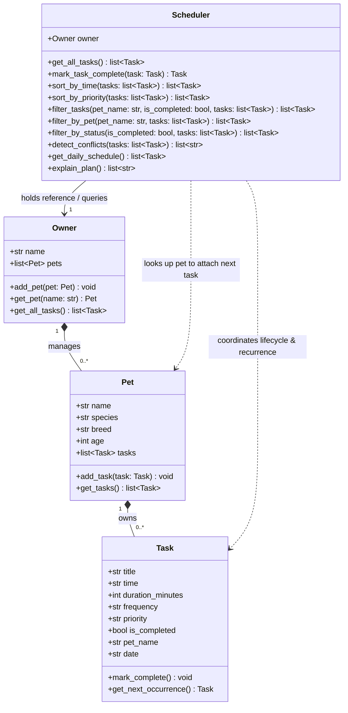

# PawPal+ (Module 2 Project)

You are building **PawPal+**, a Streamlit app that helps a pet owner plan care tasks for their pet.

## Scenario

A busy pet owner needs help staying consistent with pet care. They want an assistant that can:

- Track pet care tasks (walks, feeding, meds, enrichment, grooming, etc.)
- Consider constraints (time available, priority, owner preferences)
- Produce a daily plan and explain why it chose that plan

Your job is to design the system first (UML), then implement the logic in Python, then connect it to the Streamlit UI.

## What you will build

Your final app should:

- Let a user enter basic owner + pet info
- Let a user add/edit tasks (duration + priority at minimum)
- Generate a daily schedule/plan based on constraints and priorities
- Display the plan clearly (and ideally explain the reasoning)
- Include tests for the most important scheduling behaviors

## Getting started

### Setup

```bash
python -m venv .venv
source .venv/bin/activate  # Windows: .venv\Scripts\activate
pip install -r requirements.txt
```

### Suggested workflow

1. Read the scenario carefully and identify requirements and edge cases.
2. Draft a UML diagram (classes, attributes, methods, relationships).
3. Convert UML into Python class stubs (no logic yet).
4. Implement scheduling logic in small increments.
5. Add tests to verify key behaviors.
6. Connect your logic to the Streamlit UI in `app.py`.
7. Refine UML so it matches what you actually built.

## 🏗️ Implementation Summary

PawPal+ is built as a modular, object-oriented system in pawpal_system.py. There are four main classes:

Task is a dataclass that represents one care activity, like a feeding, a walk, or giving medication. It holds the title, scheduled time (as "HH:MM"), duration, priority (high, medium, or low), frequency (daily, weekly, or once), whether it's been completed, and which pet it belongs to. It also figures out its own next occurrence date using get_next_occurrence() and timedelta.

Pet is also a dataclass. It stores the pet's identity (name, species, breed, age) and keeps its own private list of tasks. When you call add_task(), it automatically stamps the pet's name onto the task so the attribution doesn't get lost.

Owner is a dataclass for the person caring for the pets. It has add_pet() and get_all_tasks(), and the latter goes through every pet and pulls their tasks into one combined list without exposing how things are stored internally.

Scheduler is the central coordinator and the brain of the whole thing. It takes an Owner and only talks to it through Owner.get_all_tasks(), which is what makes the multi-pet support work. From there it handles sorting by time, ordering by priority, filtering by status or pet, detecting overlaps and exact conflicts, explaining the plan, and managing the lifecycle of recurring tasks.

### How the Classes Work Together

Source: [`diagrams/uml_final.mmd`](diagrams/uml_final.mmd)



1. **Task Attribution**: When an `Owner` adds tasks to a `Pet`, the `Pet` ensures each `Task` carries its `pet_name`.
2. **Multi-Pet Retrieval**: The `Scheduler` queries `Owner.get_all_tasks()`, collecting tasks across all pets seamlessly.
3. **Smart Coordination**: The `Scheduler` sorts the master routine chronologically, detects overlapping conflicts, and when a task is completed, coordinates re-attaching the next recurring task to the correct pet.

## 🧪 Testing PawPal+

PawPal+ includes a comprehensive unit test suite built with `pytest` in `tests/test_pawpal.py` to verify domain models, scheduling logic, and edge cases.

### Running Tests

Execute the test suite using either of the following commands:

```bash
# Run tests with Python module runner:
python -m pytest

# Run tests with detailed verbose output:
python -m pytest -v
```

### What the Tests Cover

The test suite contains 18 unit tests covering four core areas:

1. **Sorting Correctness**:
   - **Chronological Ordering**: Ensures tasks entered in random or out-of-order sequences are ordered from earliest to latest.
   - **Time Parsing & Normalization**: Confirms single-digit hours (`"8:00"`) correctly sort before double-digit hours (`"10:00"`), avoiding naive string comparison errors.
   - **Day Boundaries**: Tests extreme timestamps such as midnight (`"00:15"`) and end of day (`"23:45"`).
   - **Priority Sorting**: Verifies descending priority ordering (High &rarr; Medium &rarr; Low).

2. **Recurrence Logic**:
   - **Daily Rollover**: Confirms that marking a daily task complete sets `is_completed=True` on the original task, creates a new task instance for tomorrow (`today + 1 day`) with `is_completed=False`, and attaches it to the pet.
   - **Weekly Rollover**: Validates that weekly tasks advance by exactly 7 days (`today + 7 days`).
   - **One-Time Tasks**: Verifies non-recurring tasks (`frequency="once"`) do not spawn new occurrences upon completion.
   - **Overdue Task Anchoring**: Ensures overdue tasks from past dates anchor new occurrences to `today + 1 day` so tasks are never scheduled in the past.
   - **Idempotent Completion**: Ensures calling completion repeatedly on the same task does not create duplicate recurring entries for the same date.

3. **Conflict Detection**:
   - **Exact Duplicate Times**: Flags tasks scheduled at the exact same minute, categorizing them as either `[Same-Pet]` or `[Multi-Pet]`.
   - **Interval Overlaps**: Flags when a subsequent task starts before the preceding task's duration has ended (`start < end`).
   - **Back-to-Back Precision**: Confirms tasks starting at the exact minute an earlier task ends (e.g., 08:00–08:30 and 08:30–09:00) do **not** trigger false-positive warnings.
   - **Active Task Filtering**: Ensures already completed tasks do not trigger conflicts with pending tasks.

4. **Entity Management & Filtering**:
   - **Automatic Attribution**: Adding a task to a `Pet` automatically stamps the pet's name on the task.
   - **Multi-Pet Aggregation**: `Owner.get_all_tasks()` aggregates tasks across all owned pets seamlessly.
   - **Multi-Criteria Filtering**: Tests filtering by pet name, completion status, and combined criteria.
   - **Empty States**: Confirms empty owners, pets with no tasks, and empty schedules execute gracefully without raising exceptions.

### Sample Test Output

```text
============================= test session starts =============================
platform win32 -- Python 3.15.0, pytest-9.1.1, pluggy-1.7.0
rootdir: C:\Users\jolie\Downloads\codepath\ai110-module2show-pawpal-starter
collected 18 items

tests/test_pawpal.py::test_sorting_by_time_chronological PASSED          [  5%]
tests/test_pawpal.py::test_sorting_handles_single_digit_and_boundary_hours PASSED [ 11%]
tests/test_pawpal.py::test_sorting_by_priority PASSED                    [ 16%]
tests/test_pawpal.py::test_daily_recurrence_creates_next_day_task PASSED [ 22%]
tests/test_pawpal.py::test_weekly_recurrence_creates_seven_days_later PASSED [ 27%]
tests/test_pawpal.py::test_one_time_task_does_not_recur PASSED           [ 33%]
tests/test_pawpal.py::test_recurrence_overdue_task_anchored_to_today PASSED [ 38%]
tests/test_pawpal.py::test_recurrence_idempotency_prevents_duplicate_entries PASSED [ 44%]
tests/test_pawpal.py::test_conflict_detection_flags_exact_duplicate_times_same_pet PASSED [ 50%]
tests/test_pawpal.py::test_conflict_detection_flags_exact_duplicate_times_different_pets PASSED [ 55%]
tests/test_pawpal.py::test_conflict_detection_duration_overlap PASSED    [ 61%]
tests/test_pawpal.py::test_back_to_back_tasks_do_not_conflict PASSED     [ 66%]
tests/test_pawpal.py::test_completed_tasks_do_not_trigger_daily_conflicts PASSED [ 72%]
tests/test_pawpal.py::test_task_mark_complete PASSED                     [ 77%]
tests/test_pawpal.py::test_pet_task_addition_and_attribution PASSED      [ 83%]
tests/test_pawpal.py::test_owner_multi_pet_aggregation PASSED            [ 88%]
tests/test_pawpal.py::test_filtering_by_pet_and_status PASSED            [ 94%]
tests/test_pawpal.py::test_empty_states_handled_gracefully PASSED        [100%]

============================== 18 passed in 0.06s ==============================
```

**Confidence Level**: ⭐⭐⭐⭐⭐ (5/5 stars)

## ✨ Core Algorithmic Features

PawPal+ includes six core algorithmic behaviors located in `pawpal_system.py` that power the intelligent scheduling engine:

### 1. Chronological Sorting & Normalization
* **Method**: `Scheduler.sort_by_time(tasks=None)`
* **Implementation Details**:
  * Uses Python's `sorted()` with a custom key powered by `_parse_time()` to parse `"HH:MM"` 24-hour time strings via `datetime.strptime`.
  * Safely normalizes single-digit vs. double-digit hours (e.g., `"8:00"` correctly precedes `"10:00"`), avoiding naive lexicographical string comparison errors where `"1" < "8"`.
  * Reliably handles edge cases including day boundary extremes (`"00:15"` and `"23:45"`) and preserves relative order for simultaneous appointments.

### 2. Priority-Weighted Urgency Sorting
* **Method**: `Scheduler.sort_by_priority(tasks=None)`
* **Implementation Details**:
  * Evaluates task priority strings against `PRIORITY_MAP = {"high": 1, "medium": 2, "low": 3}`.
  * Allows owners to sort active tasks by urgency during schedule crunch times, ensuring health-critical activities (such as insulin administration or medication) take precedence over flexible tasks (such as brushing or grooming).

### 3. Lightweight, Non-Blocking Conflict Detection
* **Method**: `Scheduler.detect_conflicts(tasks=None)`
* **Implementation Details**:
  * **Sweep-Line Interval Evaluation**: Sorts active schedule tasks chronologically and checks adjacent intervals. If a subsequent task starts after the current task finishes (`t2_start >= t1_end`), it safely breaks early.
  * **Collision Types**:
    * **Exact Duplicate Times**: Detects when two routines share the exact same start minute (`t2_start == t1_start`).
    * **Duration Overlaps**: Detects when a subsequent task begins before the preceding activity finishes (`t2_start < t1_end`).
  * **Scope Categorization**:
    * **`[Same-Pet]`**: Identifies when a single animal is scheduled for conflicting activities (e.g., eating while out on a walk).
    * **`[Multi-Pet]`**: Identifies caregiver bottlenecks where multiple pets require care simultaneously.
  * **Non-Crashing Architecture**: Returns structured, actionable warning strings (`List[str]`) rather than throwing exceptions, keeping the daily schedule accessible.

### 4. Intelligent Recurrence Lifecycle & Idempotency
* **Methods**: `Task.get_next_occurrence()`, `Scheduler.mark_task_complete(task)`
* **Implementation Details**:
  * **Date Arithmetic via `timedelta`**:
    * `"daily"`: Advances due date by +1 day (`today + timedelta(days=1)`).
    * `"weekly"`: Advances due date by +7 days (`today + timedelta(days=7)`).
    * `"once"`: Returns `None` (non-recurring).
  * **Overdue Task Anchoring**: Calculates the anchor date using `max(current_dt, date.today())`. If an overdue task from weeks ago is marked complete today, the next occurrence is anchored relative to today rather than the historical past.
  * **Idempotency Guard**: Before attaching a generated recurring task to a pet, `Scheduler.mark_task_complete()` checks `pet.tasks` to prevent duplicate records if a user triggers completion multiple times.
  * **Clean State Reset**: Newly generated recurring task instances inherit title, duration, priority, and frequency, while resetting `is_completed=False`.

### 5. Multi-Criteria Single-Pass Filtering
* **Methods**: `Scheduler.filter_tasks()`, `Scheduler.filter_by_pet()`, `Scheduler.filter_by_status()`
* **Implementation Details**:
  * Evaluates task subsets in a single $O(N)$ pass across multiple dimensions: case-insensitive pet name, completion status (`is_completed`), priority, or date.
  * Convenience wrappers `filter_by_pet()` and `filter_by_status()` cleanly delegate to `filter_tasks()`, powering individual pet tabs and pending dashboards.

### 6. Explainable AI & Plan Reasoning
* **Method**: `Scheduler.explain_plan()`
* **Implementation Details**:
  * Iterates through the active daily schedule and constructs human-readable rationales explaining the scheduled time, duration, priority, frequency, and why the task was sequenced in that order.

---

## 🎥 Demo Walkthrough

### 1. Main UI Features & User Actions

* **Household Pet Management (Sidebar)**:
  * View all registered pets, species, breed, age, and current task counts.
  * Add new pets to the household dynamically via the registration form.
* **Top Metric Overview**:
  * Live KPI tiles displaying **Registered Pets**, **Pending Today**, **Completed**, and **Active Conflicts** (with color-coded "Action Required" status tags).
* **Smart Daily Schedule Tab**:
  * View the master daily schedule aggregated across all household pets.
  * Switch sort orders dynamically: **Chronological Order** (earliest to latest) or **Urgency Order** (High &rarr; Medium &rarr; Low).
  * Filter schedule views by individual pet or view all pets simultaneously.
  * Interactive conflict warning drawer highlighting `[Same-Pet]` and `[Multi-Pet]` collisions with suggested fixes.
  * Plan Explanations expander showing the algorithmic rationale behind the day's plan.
* **Add Care Task Tab**:
  * Schedule new routines with time, duration, priority, and recurrence frequency.
  * Automatically sets pet attribution so tasks are never orphaned.
* **Routine Manager & Completion Tab**:
  * Filter routines by pet and completion status.
  * Check off tasks with the "Complete Task" button, triggering automated recurrence rollovers with instant feedback banners.

---

### 2. Example Step-by-Step Workflow

1. **Step 1: Register a Pet**
   * In the sidebar, enter **Pet Name** `"Milo"`, select **Species** `"Dog"`, enter **Breed** `"Beagle"`, and set **Age** `2`.
   * Click **➕ Register Pet**. Milo appears in the household overview with `0 tasks`.
2. **Step 2: Schedule Care Tasks**
   * Navigate to the **➕ Add Care Task** tab.
   * Add Task 1: Assign to `Milo`, title `"Morning Walk"`, start time `08:00`, duration `30` min, priority `high`, frequency `daily`. Click **➕ Schedule Task**.
   * Add Task 2: Assign to `Milo`, title `"Post-Walk Breakfast"`, start time `08:15`, duration `15` min, priority `high`, frequency `daily`. Click **➕ Schedule Task**.
3. **Step 3: Inspect Today's Schedule & Review Conflicts**
   * Switch to the **📅 Smart Daily Schedule** tab.
   * Notice that the **⚠️ Active Conflicts** metric updates to `1` with an "Action Required" tag.
   * An advisory warning card appears:
     > `⚠️ Overlap Conflict [Same-Pet (Milo)] at 08:15: 'Post-Walk Breakfast' (Milo) overlaps with 'Morning Walk' (Milo, starts 08:00, duration 30m).`
     > *💡 Tip: Stagger start times so the pet can finish their prior activity.*
   * Toggle sort order to **Urgency (Priority)** to see high-priority tasks prioritized at the top of the table.
4. **Step 4: Complete a Task & Observe Automatic Recurrence**
   * Open the **📋 Routine Manager & Completion** tab.
   * Locate `"Morning Walk"` and click **Complete Task**.
   * The status updates to `✅ Completed`.
   * An alert banner confirms:
     > `🎉 Completed! Next 'Morning Walk' auto-scheduled for Milo on 2026-10-22 at 08:00.`
   * In the sidebar, Milo's task counter increments, reflecting both the completed task and tomorrow's upcoming routine.

---

### 3. Key Scheduler Behaviors Demonstrated

* **Chronological Normalization**: Regardless of the order tasks are entered into the system, the daily schedule displays routines in strict chronological sequence (`08:00` &rarr; `08:45` &rarr; `14:00`).
* **Non-Blocking Safety**: Conflicts alert the user to potential bottlenecks without crashing the application or hiding the schedule.
* **Automated Recurrence Management**: Completing recurring tasks automatically handles date math and guarantees the owner never has to re-type everyday routines.
* **Encapsulated Multi-Pet Aggregation**: The `Scheduler` queries `Owner.get_all_tasks()`, enabling effortless multi-pet management from a single unified dashboard.

---

### 4. Sample CLI Demo Execution (`python main.py`)

Run the standalone CLI verification script to view the scheduling engine in action:

```bash
python main.py
```

**Terminal Output**:

```text
============================================================
🐾 PAWPAL+ PET CARE MANAGEMENT DEMO
============================================================
👤 Owner: Jordan
🐶 Added Pet: Mochi (Golden Retriever, 3 yrs)
🐱 Added Pet: Luna (Siamese, 2 yrs)

============================================================
🐾 1. RAW TASKS AS ADDED (OUT OF ORDER)
============================================================
Time     | Pet      | Task                       | Dur    | Priority | Status
---------+----------+----------------------------+--------+----------+-----------
14:00    | Mochi    | Brush Coat & Grooming      | 20m    | Medium   | Pending
19:30    | Mochi    | Evening Walk & Wind-down   | 25m    | Medium   | Pending
08:00    | Mochi    | Morning Walk & Potty       | 30m    | High     | Pending
08:45    | Mochi    | Breakfast & Supplements    | 15m    | High     | Pending
08:45    | Mochi    | Flea & Tick Prevention     | 10m    | High     | Pending
09:15    | Luna     | Catnip Play Session        | 25m    | Medium   | Pending
08:45    | Luna     | Vet Video Checkup          | 30m    | High     | Pending

============================================================
🐾 2. CHRONOLOGICALLY SORTED SCHEDULE
============================================================
Time     | Pet      | Task                       | Dur    | Priority | Status
---------+----------+----------------------------+--------+----------+-----------
08:00    | Mochi    | Morning Walk & Potty       | 30m    | High     | Pending
08:45    | Mochi    | Breakfast & Supplements    | 15m    | High     | Pending
08:45    | Mochi    | Flea & Tick Prevention     | 10m    | High     | Pending
08:45    | Luna     | Vet Video Checkup          | 30m    | High     | Pending
09:15    | Luna     | Catnip Play Session        | 25m    | Medium   | Pending
14:00    | Mochi    | Brush Coat & Grooming      | 20m    | Medium   | Pending
19:30    | Mochi    | Evening Walk & Wind-down   | 25m    | Medium   | Pending

============================================================
🐾 3. FILTER BY PET: MOCHI'S TASKS ONLY
============================================================
Time     | Pet      | Task                       | Dur    | Priority | Status
---------+----------+----------------------------+--------+----------+-----------
14:00    | Mochi    | Brush Coat & Grooming      | 20m    | Medium   | Pending
19:30    | Mochi    | Evening Walk & Wind-down   | 25m    | Medium   | Pending
08:00    | Mochi    | Morning Walk & Potty       | 30m    | High     | Pending
08:45    | Mochi    | Breakfast & Supplements    | 15m    | High     | Pending
08:45    | Mochi    | Flea & Tick Prevention     | 10m    | High     | Pending

============================================================
🐾 4. FILTER BY PET: LUNA'S TASKS ONLY
============================================================
Time     | Pet      | Task                       | Dur    | Priority | Status
---------+----------+----------------------------+--------+----------+-----------
09:15    | Luna     | Catnip Play Session        | 25m    | Medium   | Pending
08:45    | Luna     | Vet Video Checkup          | 30m    | High     | Pending

============================================================
🐾 5. LIGHTWEIGHT CONFLICT DETECTION
============================================================
Detected 3 conflict(s) (non-blocking warnings):
  ⚠️  Exact Conflict [Same-Pet (Mochi)] at 08:45: 'Breakfast & Supplements' and 'Flea & Tick Prevention' are scheduled at the exact same time.
  ⚠️  Exact Conflict [Multi-Pet (Mochi & Luna)] at 08:45: 'Breakfast & Supplements' and 'Vet Video Checkup' are scheduled at the exact same time.
  ⚠️  Exact Conflict [Multi-Pet (Mochi & Luna)] at 08:45: 'Flea & Tick Prevention' and 'Vet Video Checkup' are scheduled at the exact same time.

============================================================
🐾 6. PLAN REASONING & EXPLANATIONS
============================================================
• [08:00] Morning Walk & Potty for Mochi (30m) - Priority: HIGH | Frequency: daily. Ordered chronologically to keep Mochi's routine consistent.
• [08:45] Breakfast & Supplements for Mochi (15m) - Priority: HIGH | Frequency: daily. Ordered chronologically to keep Mochi's routine consistent.
• [08:45] Flea & Tick Prevention for Mochi (10m) - Priority: HIGH | Frequency: monthly. Ordered chronologically to keep Mochi's routine consistent.
• [08:45] Vet Video Checkup for Luna (30m) - Priority: HIGH | Frequency: once. Ordered chronologically to keep Luna's routine consistent.
• [09:15] Catnip Play Session for Luna (25m) - Priority: MEDIUM | Frequency: daily. Ordered chronologically to keep Luna's routine consistent.
• [14:00] Brush Coat & Grooming for Mochi (20m) - Priority: MEDIUM | Frequency: weekly. Ordered chronologically to keep Mochi's routine consistent.
• [19:30] Evening Walk & Wind-down for Mochi (25m) - Priority: MEDIUM | Frequency: daily. Ordered chronologically to keep Mochi's routine consistent.

============================================================
🐾 7. TASK COMPLETION & STATUS FILTERING
============================================================
Marking 'Morning Walk & Potty' as completed...
✅ Recurring task auto-generated for Mochi: 'Morning Walk & Potty' on 2026-10-22 at 08:00

============================================================
🐾 COMPLETED TASKS (FILTER_TASKS: IS_COMPLETED=TRUE)
============================================================
Time     | Pet      | Task                       | Dur    | Priority | Status
---------+----------+----------------------------+--------+----------+-----------
08:00    | Mochi    | Morning Walk & Potty       | 30m    | High     | Completed

============================================================
🐾 PENDING TASKS (FILTER_TASKS: IS_COMPLETED=FALSE)
============================================================
Time     | Pet      | Task                       | Dur    | Priority | Status
---------+----------+----------------------------+--------+----------+-----------
14:00    | Mochi    | Brush Coat & Grooming      | 20m    | Medium   | Pending
19:30    | Mochi    | Evening Walk & Wind-down   | 25m    | Medium   | Pending
08:45    | Mochi    | Breakfast & Supplements    | 15m    | High     | Pending
08:45    | Mochi    | Flea & Tick Prevention     | 10m    | High     | Pending
08:00    | Mochi    | Morning Walk & Potty       | 30m    | High     | Pending
09:15    | Luna     | Catnip Play Session        | 25m    | Medium   | Pending
08:45    | Luna     | Vet Video Checkup          | 30m    | High     | Pending
```

